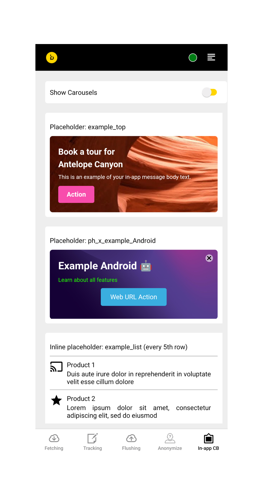

In-app content blocks provide a way to display campaigns within your mobile applications that seamlessly blend with the overall app design. Unlike [In-app messages for React Native SDK](https://documentation.bloomreach.com/engagement/docs/react-native-sdk-in-app-messages) that appear as overlays or pop-ups demanding immediate attention, in-app content blocks display inline with the app's existing content.

You can strategically position placeholders for in-app content blocks within your app. You can customize the behavior and presentation to meet your specific requirements.

> 📘
>
> Refer to the [In-app content blocks](https://documentation.bloomreach.com/engagement/docs/in-app-content-blocks) user guide for instructions on how to create in-app content blocks in {user.mkg}.



## Integration of a placeholder view

You can integrate in-app content blocks by adding one or more placeholder views in your app. Each in-app content block must have a `Placeholder ID` specified in its [settings](https://documentation.bloomreach.com/engagement/docs/in-app-content-blocks#3-fill-the-settings) in {user.mkg}. The SDK will display an in-app content block in the corresponding placeholder in the app if the current app user matches the target audience. In-app content block is shown until user interacts with it or placeholder view instance is reloaded programmatically.

### Add a placeholder view

Add a placeholder view with the specified `placeholderId` to your layout:

```typescript
<InAppContentBlocksPlaceholder
  style={{
    width: '100%',
  }}
  placeholderId={'placeholder_1'}
/>
```

The in-app content block will be shown exactly where you'll place the placeholder UI view.

After the SDK [initializes](https://documentation.bloomreach.com/engagement/docs/android-sdk-setup#initialize-the-sdk), it will identify any in-app content blocks with matching placeholder ID and select the one with the highest priority to display within the placeholder view.

> 📘
>
> Refer to [InAppCbScreen.tsx](https://github.com/exponea/exponea-react-native-sdk/blob/main/example/src/screens/InAppCbScreen.tsx) in the [Example app for React Native SDK](https://documentation.bloomreach.com/engagement/docs/react-native-sdk-example-app) for a reference implementation.

> 👍
>
> Always us descriptive, human-readable placeholder IDs. They are tracked as an event property and can be used for analytics within {user.mkg}.

## Integration of a carousel view

If you want to show multiple in-app content blocks to the user for the same `Placeholder ID`, consider using `ContentBlockCarouselView`. The SDK will display the in-app content blocks for the current app user in a loop, in order of `Priority`. The in-app content blocks are displayed in a loop until the user interacts with them or until the carousel view instance is reloaded programmatically.

If the carousel view's placeholder ID only matches a single in-app content block, it will behave like a static placeholder view with no loop effect.

### Add a carousel view

Add a carousel view with the specified `placeholderId` to your layout:

```typescript
<ContentBlockCarouselView
  style={{
    width: '100%',
  }}
  placeholderId={'example_carousel'}
  scrollDelay={5} // delay in seconds between automatic scroll; 0 for no scroll; default value is 3
  maxMessagesCount={5} // max count of visible content blocks; 0 for show all; default value is 0
/>
```

> 📘
>
> Refer to [CarouselScreen.tsx](https://github.com/exponea/exponea-react-native-sdk/blob/main/example/src/screens/CarouselScreen.tsx) in the [Example app for React Native SDK](https://documentation.bloomreach.com/engagement/docs/react-native-sdk-example-app) for a reference implementation.

> 👍
>
> Always us descriptive, human-readable placeholder IDs. They are tracked as an event property and can be used for analytics within {user.mkg}.

## Tracking

The SDK automatically tracks `banner` events for in-app content blocks with the following values for the `action` event property:

- `show`
  In-app content block has been displayed to user.
  Event is tracked everytime if Placeholder view is used. Carousel view tracks this event only if content block is shown for first time after `reload` (once per rotation cycle).
- `action`
  User clicked on action button inside in-app content block. The event also contains the corresponding `text` and `link` properties.
- `close`
  User clicked on close button inside in-app content block.
- `error`
  Displaying in-app content block failed. The event contains an `error` property with an error message.

> ❗️
>
> The behavior of in-app content block tracking may be affected by the tracking consent feature, which in enabled mode requires explicit consent for tracking. Refer to the [Tracking consent for React Native SDK](https://documentation.bloomreach.com/engagement/docs/react-native-sdk-tracking-consent) documentation for details.

## Customization

### Prefetch in-app content blocks

The SDK can only display an in-app content block after it has been fully loaded (including its content, any images, and its height). Therefore, the in-app content block may only show in the app after a delay.

You can hide this delay by prefetching the content for specific placeholders before the user reaches the screen that renders them. Use `Exponea.inAppContentBlocksController.prefetch()`, which is the only runtime prefetch API. For details, see [Control in-app content blocks at runtime](#control-in-app-content-blocks-at-runtime). The existing `InAppContentBlocksPlaceholder` and `ContentBlockCarouselView` components still handle rendering and tracking.

```typescript
import Exponea from 'react-native-exponea-sdk';

// Call this as soon as the destination screen (and its placeholder IDs) is known,
// for example when the user taps a navigation item.
await Exponea.inAppContentBlocksController?.prefetch(['placeholder_1']);
```

Alternatively, if the placeholder IDs are static, list them in the `inAppContentBlockPlaceholdersAutoLoad` [configuration parameter](https://documentation.bloomreach.com/engagement/docs/react-native-sdk-configuration), and the SDK loads them right after initialization. Use the runtime controller when IDs depend on navigation, customer identity, or CMS layout.

### Control in-app content blocks at runtime

`Exponea.inAppContentBlocksController` is a runtime controller for in-app content blocks. It lets you prefetch content before navigation, make a time-bounded rendering decision, and evict content that you know has changed. The controller loads content in the background, and the existing placeholder and carousel components still handle rendering and tracking.

The controller changes with the SDK state as follows:

- Before you call `configure()`, the controller is `null`.
- After a successful `configure()`, the controller is available.
- If you call `configure()` again while the SDK is already configured, the controller stays the same instance.
- After `identifyCustomer()` or `anonymize()`, the controller stays the same instance. The native SDK resets its cache on a customer change, so prefetch again afterward.
- After a successful `stopIntegration()`, the controller is `null`.
- After a `configure()` call that follows `stopIntegration()`, the controller is a new instance.

Read `Exponea.inAppContentBlocksController` each time you need it instead of keeping a long-lived reference. A reference that you keep across `stopIntegration()` rejects every call.

```typescript
import Exponea from 'react-native-exponea-sdk';

const controller = Exponea.inAppContentBlocksController;
if (!controller) {
  // SDK is not configured; render your fallback.
  return;
}
```

#### Which API to use

| API                              | Use it when                                                                                            | Result                                                                                                                      |
| -------------------------------- | ------------------------------------------------------------------------------------------------------ | --------------------------------------------------------------------------------------------------------------------------- |
| `prefetch(ids, deadlineMs?)`     | The IDs for a future screen are already known, and you want to prefetch the content before navigation. | `Promise` that resolves to a map from each distinct ID to `InAppContentBlockAvailability` (`ready`, `empty`, or `loading`). |
| `availability(id, deadlineMs)`   | The current screen must decide whether to render one placement or a fallback within a deadline.        | `Promise` of `{ status: 'resolved', availability: 'ready' \| 'empty' }` or `{ status: 'timedOut' }`.                        |
| `invalidate(ids, reason, mode?)` | The content of a placement changed in {user.mkg}, and the SDK must no longer show the cached version.  | `Promise<void>` that resolves after the native controller accepts the request.                                              |

`prefetch` accepts multiple placeholder IDs and deduplicates repeated IDs. Use it to hide loading time before a user reaches a screen. `availability` accepts only a single ID because it represents one UI decision. All three methods return a `Promise` and reject if the native SDK isn't configured.

#### Handle errors

Runtime methods reject their Promises with `Error` objects. Known error codes are consistent across the JavaScript wrapper and the iOS and Android bridges:

| Error code                                      | Meaning                                                                                                                                              |
| ----------------------------------------------- | ---------------------------------------------------------------------------------------------------------------------------------------------------- |
| `RuntimeInAppContentBlockControllerUnavailable` | The native controller is unavailable because the SDK isn't configured or because `stopIntegration()` deactivated the JavaScript controller instance. |
| `RuntimeInAppContentBlockControllerInvalidMode` | The bridge received an unsupported invalidation mode. Use `InAppContentBlockInvalidateMode.EAGER` or `.LAZY`.                                        |
| `RuntimeInAppContentBlockControllerError`       | An unexpected native failure occurred. Native error details are preserved.                                                                           |

A deactivated instance remains unusable even after you configure the SDK again. Get a new instance from `Exponea.inAppContentBlocksController` after configuration succeeds. Reading a `null` controller isn't an error, and optional chaining skips the operation.

```typescript
import Exponea from 'react-native-exponea-sdk';

const controller = Exponea.inAppContentBlocksController;
if (controller) {
  try {
    await controller.prefetch(['example_list']);
  } catch (error: unknown) {
    const code =
      typeof error === 'object' && error !== null && 'code' in error
        ? error.code
        : undefined;
    if (code === 'RuntimeInAppContentBlockControllerUnavailable') {
      // Show your fallback. Obtain a fresh controller after configuration.
    } else {
      console.warn('Content block prefetch failed', error);
    }
  }
}
```

An availability timeout is a `{ status: 'timedOut' }` decision, not a `Promise` rejection. An `empty` availability result is also a normal result.

#### Warm content before navigation

Start prefetching as soon as you know the destination or its layout. Once an ID is `ready`, mount the corresponding `InAppContentBlocksPlaceholder` (or `ContentBlockCarouselView`) to use the prefetched content. Prefetching reduces loading work, but it doesn't guarantee immediate display, because display eligibility, rendering, and layout still apply.

```typescript
import Exponea, {
  InAppContentBlockAvailability,
} from 'react-native-exponea-sdk';

async function openProductList(): Promise<void> {
  const results = await Exponea.inAppContentBlocksController?.prefetch(
    ['example_list'],
    2000
  );
  if (results?.example_list === InAppContentBlockAvailability.READY) {
    // Content is warmed; mount the placeholder on the destination screen.
    // Display eligibility, rendering, and layout still apply.
  }
  navigation.navigate('ProductList');
}
```

The deadline is optional. Without one, the `Promise` waits for final states (`ready` or `empty`). With a deadline, the `Promise` reports every ID that hasn't resolved by that time as a snapshot: `loading` on iOS and `empty` on Android. In both cases, the value is temporary and doesn't prove that no campaign exists. The background request continues and might populate the cache later. To decide the UI fallback, use `availability` instead of a deadline-bound `prefetch` result.

#### Make a bounded rendering decision

Use `availability` when waiting too long would make the screen feel slow and a fallback is acceptable.

```typescript
import Exponea, {
  InAppContentBlockAvailability,
} from 'react-native-exponea-sdk';

const decision = await Exponea.inAppContentBlocksController?.availability(
  'example_list',
  2000
);

if (decision?.status === 'resolved') {
  if (decision.availability === InAppContentBlockAvailability.READY) {
    setShowContentBlock(true); // mount <InAppContentBlocksPlaceholder placeholderId="example_list" />
  } else {
    setShowContentBlock(false); // 'empty': load completed without renderable content
  }
} else {
  setShowContentBlock(false); // 'timedOut' or SDK not configured: show your own fallback
}
```

`resolved` with `empty` means the load completed without renderable content. `timedOut` means only that this caller stopped waiting. It doesn't cancel the load, so a later `availability` call or a placeholder mount can use content that finishes loading afterward. A resolved decision is never `loading`.

#### Calling both APIs for the same ID

Calling the following methods together is safe:

```typescript
const controller = Exponea.inAppContentBlocksController;
controller?.prefetch(['example_list'], 2000);
const decision = await controller?.availability('example_list', 2000);
```

They share one in-flight load for `example_list` and don't create two initial requests. Each `Promise` still resolves exactly once with its own result type. Use this pairing when the screen needs both proactive prefetching and a deadline-based UI fallback. In most flows, prefetching before navigation is enough.

With a deadline of zero or a negative value, both methods return immediately:

- `availability` resolves `timedOut`.
- `prefetch` returns cached terminal states and the snapshot value for other IDs.

Both still start or continue populating the cache in the background.

#### Prefetch after identifying the customer

Content block eligibility depends on the customer. The native SDK resets its runtime cache when the customer changes, so a prefetch issued before `identifyCustomer()` resolves may be evaluated for the previous (anonymous) customer. Order the calls as follows:

```typescript
import Exponea from 'react-native-exponea-sdk';

await Exponea.identifyCustomer({ registered: 'user@example.com' });
// The controller instance is unchanged, only its cache was reset.
await Exponea.inAppContentBlocksController?.prefetch([
  'home_banner',
  'home_list',
]);
```

The same applies after `anonymize()`.

#### Invalidate changed content

`invalidate(ids, reason, mode)` evicts the cached content of the given placements. In the default `InAppContentBlockInvalidateMode.EAGER` mode, it also immediately starts a fresh load. In `InAppContentBlockInvalidateMode.LAZY` mode, it only evicts, and the next `prefetch`, `availability`, or placeholder load fetches the content.

The `reason` is a local diagnostic label that the SDK writes to verbose logs only. The SDK never persists it or sends it over the network. The method accepts unknown IDs and starts loading them.

```typescript
import Exponea, {
  InAppContentBlockInvalidateMode,
} from 'react-native-exponea-sdk';

await Exponea.inAppContentBlocksController?.invalidate(
  ['example_list'],
  'content updated in CMS',
  InAppContentBlockInvalidateMode.EAGER
);
```

> ❗️
>
> Call `invalidate` only when the placement's source content has changed. Don't call it to acknowledge or consume a successful prefetch. Calling it right after a `ready` result discards the prefetched content and triggers another request.

##### Refresh a mounted placeholder after invalidate

The controller only evicts and reloads cached content. It doesn't refresh an `InAppContentBlocksPlaceholder` or `ContentBlockCarouselView` that's already mounted, so the view keeps showing the content it loaded. To display the refreshed content, remount the view by changing its React `key`. This creates a new native view that loads the invalidated placement again. The example app's runtime lab uses the same pattern.

```typescript
import React, { useState } from 'react';
import Exponea, { InAppContentBlocksPlaceholder } from 'react-native-exponea-sdk';

function PromoBanner(): React.ReactElement {
  const [bannerKey, setBannerKey] = useState(0);

  async function onPromoCodeApplied(): Promise<void> {
    await Exponea.inAppContentBlocksController?.invalidate(
      ['promo_banner'],
      'promo code applied'
    );
    // A new key mounts a new native view, which loads the fresh content.
    setBannerKey((current) => current + 1);
  }

  return (
    <InAppContentBlocksPlaceholder
      key={bannerKey}
      placeholderId="promo_banner"
      style={{ width: '100%' }}
    />
  );
}
```

A remount briefly resets the placeholder height, and the SDK tracks a new `show` event for the content block. Content that mounts for the first time after `invalidate` doesn't need special handling.

#### Try the runtime controller in the example app

Open the in-app content blocks screen and select **Runtime Control**. The **Basic** tab contains the existing placeholder and carousel examples. The runtime lab accepts comma-separated or newline-separated placeholder IDs and a deadline in milliseconds. The lab records method results and placeholder events in a log that you can share.

The **happy path** and **post-login CMS** scenarios prefetch and then mount placeholders to display eligible content. React Native starts loading automatically when a placeholder mounts. The other scenarios test prefetch, availability, eager or lazy invalidation, and customer lifecycle changes without mounting new placeholders. Blocks already mounted in the lab remain mounted during those scenarios. The happy path and post-login scenarios replace them when they mount new views. Switching away from the runtime tab unmounts the lab.

The identity scenarios change the SDK customer to `user_a`, `user_b`, or an anonymous customer. The timeout scenario uses a 1 ms deadline, but a fast response can still resolve within that time. Check the actual decision in the log.

The app keeps the last placeholder IDs and deadline across tab and screen changes during the current JavaScript app session. Restarting or reloading the app resets them. The lab doesn't keep logs and mounted views when it unmounts.

### Handle carousel presentation status

You can register a multiple callbacks to a carousel view instance to retrieve information for each update and/or change behaviour by setting the `trackActions` and `overrideDefaultBehavior` flags.

- trackActions
  - If `false`, events "close" and "click" on banners won't be tracked by the SDK. Events "show" and "error" are tracked regardless from this flag.
  - If `true`, events "close" and "click" are tracked by the SDK.
  - Default behaviour is as with value `true`, all events are tracked by the SDK
- overrideDefaultBehavior
  - If `true`, deep-links and universal links won't be opened by SDK. This does not affect tracking behaviour.
  - If `false`, deep-links and universal links will be opened by SDK.
  - Default behaviour is as with value `false`, action links are opened by SDK.

```typescript
<ContentBlockCarouselView
  style={{
    width: '100%',
  }}
  placeholderId={'example_carousel'}
  // If overrideDefaultBehavior is set to true, default action will not be performed (deep link, universal link, etc.)
  overrideDefaultBehavior={false}
  // If trackActions is set to false, click and close in-app content block events will not be tracked automatically
  trackActions={true}
  onMessageShown={(_placeholderId, contentBlock, index, count) => {
    // This is triggered on each scroll so 'contentBlock' parameter represents currently shown content block,
    // so as 'index' represents position index of currently shown content block
  }}
  onMessagesChanged={(count, contentBlocks) => {
    // This is triggered after 'reload' or if a content block is removed because interaction has been done
    // and message has to be shown until interaction.
  }}
  onNoMessageFound={(placeholderId) => {
    // This is triggered after `reload` when no content block has been found for a given placeholder.
  }}
  onError={(placeholderId, contentBlock, errorMessage) => {
    // This is triggered when an error occurs while loading or showing of content block.
    // Parameter `contentBlock` is the content block which caused the error or undefined in case of general problem.
    // Parameter `errorMessage` is the error message that describes the problem.
  }}
  onCloseClicked={(placeholderId, contentBlock) => {
    // This is triggered when a content block is closed.
  }}
  onActionClicked={(placeholderId, contentBlock, action) => {
    // This is triggered when a content block action is clicked.
    // Parameter `action` contains the action information.
  }}
/>
```

### Customize carousel view filtration and sorting

A carousel view filters available content blocks in the same way as a placeholder view:

- The content block must meet the `Schedule` setting configured in the {user.mkg} web app
- The content block must meet the `Display` setting configured in the {user.mkg} web app
- The content must be valid and supported by the SDK

The order in which content blocks are displayed is determined by:

1. By the `Priority` setting, descending
2. By the `Name`, ascending (alphabetically)

You can implement additional filtration and sorting by registering your own `filterContentBlocks` and `sortContentBlocks` on the carousel view instance:

```typescript
<ContentBlockCarouselView
  style={{
    width: '100%',
  }}
  placeholderId={'example_carousel'}
  filterContentBlocks={(source) => {
    // if you want keep default filtration, do not register this method
    // you can add your own filtration, for example ignore any item named "discarded"
    return source.filter(
      (item) => item.name?.toLowerCase().indexOf('discarded') >= 0
    );
  }}
  sortContentBlocks={(source) => {
    // if you want to keep default sort, do not register this method
    // you can bring your own sorting, for example reverse default sorting result
    return source.reverse();
  }}
/>
```

> ❗️
>
> A carousel view accepts the results from the filtration and sorting implementations. Ensure that you return all wanted items as result from your implementations to avoid any missing items.

> ❗️
>
> A carousel view can be configured with `maxMessagesCount`. Any value higher than zero applies a maximum number of content blocks displayed, independently of the number of results from filtration and sorting methods. So if you return 10 items from filtration and sorting method but `maxMessagesCount` is set to 5 then only first 5 items from your results.

## Troubleshooting

This section provides helpful pointers for troubleshooting in-app content blocks issues.

> 👍 Enable verbose logging
> The SDK logs a lot of information in verbose mode while loading in-app content blocks. When troubleshooting in-app content block issues, first ensure to set the SDK's log level (see [Initial setup for React Native SDK](https://documentation.bloomreach.com/engagement/docs/react-native-sdk-setup#log-level)) to `VERBOSE`.

### In-app content block not displayed

- The SDK can only display an in-app content block after it has been fully loaded (including its content, any images, and its height). Therefore, the in-app content block may only show in the app after a delay.
- Always ensure that the placeholder IDs in the in-app content block configuration (in the {user.mkg} web app) and in your mobile app match.

### In-app content block shows incorrect image

- To reduce the number of API calls and fetching time of in-app content blocks, the SDK caches the images contained in content blocks. Once the SDK downloads an image, an image with the same URL may not be downloaded again. If a content block contains a new image with the same URL as a previously used image, the previous image is displayed since it was already cached. For this reason, we recommend always using different URLs for different images.

### Log messages

While troubleshooting in-app content block issues, you can find useful information in the messages logged by the SDK at verbose log level.

Please refer to the [Android](https://documentation.bloomreach.com/engagement/docs/android-sdk-in-app-content-blocks#log-messages) and [iOS](https://documentation.bloomreach.com/engagement/docs/ios-sdk-in-app-content-blocks#log-messages) documentation for the relevant log messages for each platform.
